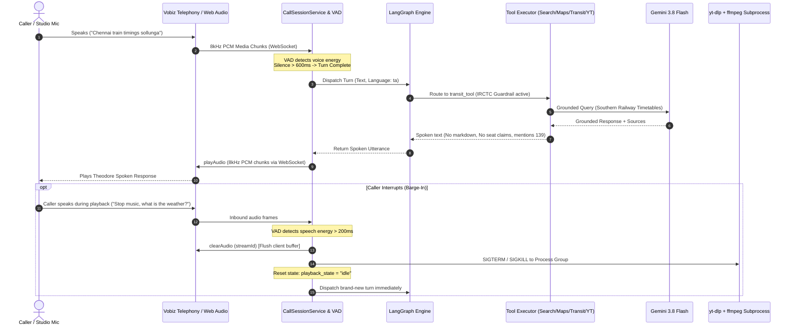
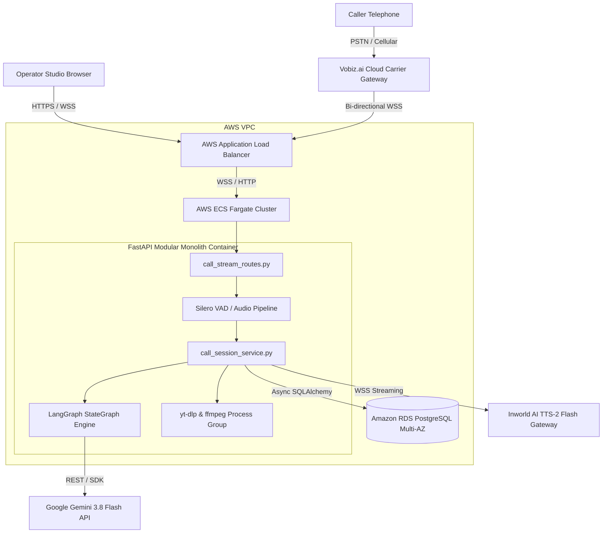

# SOLDEF-VoiceCallAI-ST-101 — Grounded Multilingual Telephony AI Assistant & Streaming Control System

### <u>Project Details</u>
- **Project ID:** PROJ-VOICE-001  
- **Project Name:** Grounded Multilingual Telephony AI Assistant ("Theodore")  

### <u>Story Details</u>
- **Story ID:** ST-101  
- **Story Name:** Real-time Conversational Telephony Core, Live Grounded Search/Maps, Public Transit Guidance, Tool-Based Media/Reminders & Low-Latency Audio Streaming Pipeline  
- **Story Description:**  
  Design and implement the production architecture for "Theodore", an interactive telephony voice assistant built on a Python FastAPI modular monolith following strict architectural separation (`agents`, `tools`, `prompts`, `client`, `service`, `repository`, `schema`, `database`, `settings`, `constants`, `utils`, `exception`, `routes`, `models`, `dependencies`). The system manages bi-directional 8kHz linear PCM telephony WebSockets (via Vobiz.ai) and web studio simulator audio channels. It supports bilingual (Tamil, English, and Tanglish) dialogue handling, live internet grounding via Gemini models (`ChatGoogle` / `google-genai`), tool-encapsulated capabilities for YouTube audio streaming (`yt-dlp` + `ffmpeg` direct stdin/stdout piping), outbound voice reminders, RSS news aggregations, Voice Activity Detection (VAD) turn-taking, and instant voice barge-in stream termination with a seamless conversation reset workflow.

---

### <u> Table of Contents </u>
- [Section 1: Functional Requirements](#section-1-functional-requirements)
    - [1.1 Overview](#11-overview)
    - [1.2 Requirement Details](#12-requirement-details)
        - [1.2.1 REQ-001: Bi-directional Telephony & Web Audio WebSocket Orchestrator](#121-req-001-bi-directional-telephony--web-audio-websocket-orchestrator)
        - [1.2.2 REQ-002: Dynamic Language Detection & Conversation State Management](#122-req-002-dynamic-language-detection--conversation-state-management)
        - [1.2.3 REQ-003: Live Product Search & E-Commerce Comparison Tool](#123-req-003-live-product-search--e-commerce-comparison-tool)
        - [1.2.4 REQ-004: Local Service Provider Lookup Tool](#124-req-004-local-service-provider-lookup-tool)
        - [1.2.5 REQ-005: Public Transport Guidance & Transit Guardrail Tool](#125-req-005-public-transport-guidance--transit-guardrail-tool)
        - [1.2.6 REQ-006: Outbound Voice Reminder Scheduling Tool](#126-req-006-outbound-voice-reminder-scheduling-tool)
        - [1.2.7 REQ-007: Zero-Delay YouTube Audio Streaming Tool](#127-req-007-zero-delay-youtube-audio-streaming-tool)
        - [1.2.8 REQ-008: Tamil & English News RSS Aggregator & Voice Synthesis](#128-req-008-tamil--english-news-rss-aggregator--voice-synthesis)
        - [1.2.9 REQ-009: Operator Web Studio & Grounded Audit Log Viewer](#129-req-009-operator-web-studio--grounded-audit-log-viewer)
        - [1.2.10 REQ-010: Audio Barge-In Interrupt, Stream Cutoff & Conversation Reset Handling](#1210-req-010-audio-barge-in-interrupt-stream-cutoff--conversation-reset-handling)
    - [1.3 Project Artifacts](#13-project-artifacts)
    - [1.4 Dependencies & Tech Stack](#14-dependencies--tech-stack)
- [Section 2: Non Functional Requirements](#section-2-non-functional-requirements)
    - [2.1 Infrastructure and Deployment](#21-infrastructure-and-deployment)
        - [2.1.1 Overview](#211-overview)
        - [2.1.2 Requirement Details](#212-requirement-details)
            - [2.1.2.1 NFR-001: Asynchronous WebSocket Stream Concurrency](#2121-nfr-001-asynchronous-websocket-stream-concurrency)
            - [2.1.2.2 NFR-002: Subprocess Lifecycle & Zombie Process Prevention](#2122-nfr-002-subprocess-lifecycle--zombie-process-prevention)
        - [2.1.3 Project Artifacts](#213-project-artifacts)
        - [2.1.4 Dependencies](#214-dependencies)
    - [2.2 Architecture and System Design](#22-architecture-and-system-design)
        - [2.2.1 Security and Compliance](#221-security-and-compliance)
        - [2.2.2 System Performance](#222-system-performance)
        - [2.2.3 Availability and Reliability](#223-availability-and-reliability)
        - [2.2.4 Cost Efficiency](#224-cost-efficiency)
        - [2.2.5 Traceability and Observability](#225-traceability-and-observability)
- [Section 3: In Scope and Out Scope](#section-3-in-scope-and-out-scope)
    - [3.1 In Scope Details](#31-in-scope-details)
    - [3.2 Out Scope Details](#32-out-scope-details)
- [Section 4: Solution Diagrams](#section-4-solution-diagrams)
    - [4.1 UI/UX Design Diagram](#41-uiux-design-diagram)
    - [4.2 Architecture Design Diagram](#42-architecture-design-diagram)
    - [4.3 Infrastructure Design Diagram](#43-infrastructure-design-diagram)

---

### <u> Section 1: Functional Requirements </u>

#### <u> 1.1 Overview </u>
The Theodore conversational telephony core implements an asynchronous, low-latency voice pipeline designed to interface with telecommunications carrier networks via Vobiz.ai bidirectional WebSockets as well as web-based operator testing simulators. Built as a modular FastAPI monolith conforming to the Python Agent Development Standard, the system isolates presentation routes (`src/routes/`), application orchestration services (`src/service/`), agent state graphs (`src/agents/`), executable tools (`src/tools/`), domain personas (`src/prompts/`), external integrations (`src/client/`), and persistent data layers (`src/schema/`, `src/repository/`).

The voice pipeline receives 8kHz mono PCM or μ-law speech chunks, evaluates speech frames with real-time Voice Activity Detection (VAD), orchestrates agent turns via a compiled LangGraph `StateGraph`, executes tool invocations for Google Search and Google Maps grounding, enforces strict capability guardrails around public transit ticketing (IRCTC boundaries), schedules automated outbound reminder calls, streams zero-disk-latency YouTube audio feeds via direct `yt-dlp` to `ffmpeg` piping, and executes sub-300ms barge-in stream termination to immediately clear audio queues upon user interruption.

---

#### <u> 1.2 Requirement Details </u>
* **REQ-001: Bi-directional Telephony & Web Audio WebSocket Orchestrator**
* **REQ-002: Dynamic Language Detection & Conversation State Management**
* **REQ-003: Live Product Search & E-Commerce Comparison Tool**
* **REQ-004: Local Service Provider Lookup Tool**
* **REQ-005: Public Transport Guidance & Transit Guardrail Tool**
* **REQ-006: Outbound Voice Reminder Scheduling Tool**
* **REQ-007: Zero-Delay YouTube Audio Streaming Tool**
* **REQ-008: Tamil & English News RSS Aggregator & Voice Synthesis**
* **REQ-009: Operator Web Studio & Grounded Audit Log Viewer**
* **REQ-010: Audio Barge-In Interrupt, Stream Cutoff & Conversation Reset Handling**

---

##### <u> 1.2.1 REQ-001: Bi-directional Telephony & Web Audio WebSocket Orchestrator </u>

##### Description:
Provide a unified WebSocket server endpoint (`/api/v1/telephony/stream/{session_id}`) capable of ingesting raw telephony streams from Vobiz.ai as well as browser Web Audio streams from the Operator Studio. When an incoming call arrives, Vobiz queries the webhook route (`POST /api/v1/telephony/webhook`) which returns a VobizXML payload instructing Vobiz to establish a bidirectional stream:
```xml
<Response>
  <Stream bidirectional="true" keepCallAlive="true" url="wss://YOUR_DOMAIN/api/v1/telephony/stream/{session_id}" />
</Response>
```
Upon connection, Vobiz sends a `start` JSON event containing `callId`, `streamId`, and `mediaFormat` (`audio/x-l16` or `audio/x-mulaw` at 8000Hz). Inbound speech arrives approximately 50 times per second wrapped in JSON `media` events containing base64 audio frames. Outbound synthesized speech is pushed back to Vobiz over the same socket using the top-level `streamId` format:
```json
{
  "event": "playAudio",
  "streamId": "STREAM_ID",
  "media": {
    "contentType": "audio/x-l16",
    "sampleRate": 8000,
    "payload": "BASE64_PCM_CHUNK"
  }
}
```

##### Voice Activity Detection (VAD) Mechanics:
1. **Frame Buffering**: Audio chunks are broken into 20ms frames (160 samples at 8kHz, 16-bit PCM).
2. **Energy & Spectral Evaluation**: Evaluated using Silero VAD (ONNX runtime) / WebRTC VAD Mode 3.
3. **Turn-Taking Boundary**: When speech is detected, an utterance buffer accumulates frames. If continuous non-speech/silence exceeds **600ms** (hangover window), the turn boundary (End of Speech) is locked, and the accumulated audio buffer is dispatched to speech-to-text / LangGraph orchestrator.
4. **Latency Budget**: Turn boundary isolation completes within < 150ms of the 600ms silence threshold.

##### Acceptance Criteria:
1. WebSocket router handles concurrent calls without frame drop or socket starvation.
2. Handshake reliably parses Vobiz `start` event and registers active `streamId` and `callId`.
3. VAD reliably isolates turn boundaries with silence threshold at 600ms.
4. Every turn logs structured audit telemetry with `session_id` and `correlation_id`.

---

##### <u> 1.2.2 REQ-002: Dynamic Language Detection & Conversation State Management </u>

##### Description:
The LangGraph agent dynamically evaluates caller utterances across three linguistic modes: Tamil (`ta`), English (`en`), and Tanglish (Tamil-English code-switched transliteration). The system persists turn state inside `CallSessionState`:
- `chat_history`: List of BaseMessage (System, Human, AI, Tool).
- `detected_language`: Active linguistic preference (`ta`, `en`, `tanglish`).
- `active_media_pid`: PID of active `ffmpeg`/`yt-dlp` subprocess.
- `playback_state`: `"idle"` | `"speaking"` | `"streaming"` | `"interrupted"`.
- `correlation_id`: Distributed tracing UUID.

##### Language Adaptation Workflow:
1. Linguistic classifier node inspects incoming transcript tokens and Unicode scripts (Tamil Unicode block `0x0B80`–`0x0BFF` vs. Romanized phonetic Tanglish keywords).
2. Session state is updated within 1 turn upon code-switching.
3. Theodore persona prompt instructions adjust output generation to match the caller's language without explicit confirmation prompts.

##### Acceptance Criteria:
1. System automatically pivots output language within 1 turn when a user switches between Tamil and English.
2. Tanglish inputs (e.g., *"Chennai central ku train timings enna?"*) are correctly comprehended and answered conversationally in Tanglish or spoken Tamil.

---

##### <u> 1.2.3 REQ-003: Live Product Search & E-Commerce Comparison Tool </u>

##### Description:
Encapsulate real-time e-commerce product pricing, technical specs, and availability inside `src/tools/search_tool.py`. Bound to `ChatGoogle` / `@google/genai` with native `googleSearch` tool grounding.

##### Voice Delivery Prompt Contract (`CRIT-VOICE-01`):
Responses are delivered verbally over a phone line. The prompt contract strictly enforces:
- Zero markdown syntax (no `**bold**`, `# headers`, `* bullets`).
- Zero raw URLs or domain dumps (e.g. *"http://..."* is banned).
- Max 3 spoken sentences per turn unless user explicitly asks for detailed specs.
- Spoken currency articulation (e.g. *"Twenty-four thousand nine hundred rupees"*).

##### Acceptance Criteria:
1. Queries retrieve live pricing from trusted retailers using Google Search grounding.
2. Response text contains zero markdown asterisks or bullet points.
3. Grounding citation URLs are preserved in the session metadata payload for UI display.

---

##### <u> 1.2.4 REQ-004: Local Service Provider Lookup Tool </u>

##### Description:
Provide nearby location lookups (mechanics, clinics, pharmacies, restaurants) through `src/tools/maps_tool.py` leveraging Google Maps tool bindings.

##### Technical Isolation:
Google Maps grounding tool bindings are executed in isolation without combining them with standard web search parameters in the same model call, extracting verified location names, addresses, and Google Maps attribution URIs (`groundingChunks.maps.uri`).

##### Acceptance Criteria:
1. Extracts valid places with proximity and contact phone numbers.
2. Extracts and logs attribution URIs without reading them aloud over the telephony line.

---

##### <u> 1.2.5 REQ-005: Public Transport Guidance & Transit Guardrail Tool </u>

##### Description:
Deliver public transport corridor guidance (Chennai Metro, suburban trains, Southern Railway IRCTC schedules) via `src/tools/transit_tool.py`, enforcing the strict safety boundary `CRIT-TRANSIT-01` defined in `src/prompts/tools/transit_rules.py`.

##### Capability Boundary Guardrail (`CRIT-TRANSIT-01`):
1. **Allowed**: Official train numbers, station halts, scheduled departure/arrival times, platform numbers, and general route frequencies via live search grounding.
2. **Prohibited**: Claiming live reservation seat availability (e.g. *"Only 3 Tatkal berths left"* is strictly forbidden).
3. **Mandatory Fallback**: Direct callers to the official Railway helpline (`139`) and prompt to set a travel reminder for chart preparation or booking windows.

##### Acceptance Criteria:
1. Retrieves official train schedules and route numbers accurately.
2. Enforces refusal of live seat availability assertions, proactively citing helpline `139`.

---

##### <u> 1.2.6 REQ-006: Outbound Voice Reminder Scheduling Tool </u>

##### Description:
Allow callers to schedule reminders (medications, train departures, bill payments) conversationally. The tool `src/tools/reminder_tool.py` parses temporal expressions (e.g., *"remind me at 8 PM today"*, *"tomorrow morning 9 AM"*) into UTC ISO timestamps, persisting records via `src/repository/reminder_repository.py` into the `voice_reminders` database table.

##### Outbound Voice Trigger:
A background async worker evaluates due reminders every 60 seconds (`SELECT * FROM voice_reminders WHERE status = 'pending' AND scheduled_time_utc <= NOW()`). It triggers an outbound call via Vobiz REST API (`POST https://api.vobiz.ai/api/v1/Account/{AccountSid}/Call`), delivers the synthesized voice message, and marks status as `completed`.

##### Acceptance Criteria:
1. Natural language relative and absolute times accurately resolve to UTC timestamps.
2. Due reminders initiate outbound Vobiz phone calls with the reminder text.

---

##### <u> 1.2.7 REQ-007: Zero-Delay YouTube Audio Streaming Tool </u>

##### Description:
Enable callers to request music or audio tracks (e.g. *"Play classical instrumental"* or *"Play MS Subbulakshmi song"*). `src/tools/youtube_tool.py` resolves the YouTube audio stream URL using `src/client/ytdlp_client.py` (`yt-dlp -g -f bestaudio <query>`) and pipes stdout directly into an `ffmpeg` transcoding subprocess (`src/client/ffmpeg_manager.py`) without writing any temporary files to disk.

##### Subprocess Pipeline Command:
```bash
ffmpeg -re -i "<STREAM_URL>" -f s16le -ac 1 -ar 8000 -loglevel quiet pipe:1
```
The raw 8kHz linear PCM frames from `pipe:1` are chunked into 320-byte buffers (20ms frames) and pushed immediately over the active Vobiz WebSocket via `playAudio` messages.

##### Acceptance Criteria:
1. Audio streams directly from subprocess stdout to WebSocket without temporary disk files.
2. Initial frame latency remains < 1.5 seconds from invocation.
3. Subprocess PID is saved in the session state for immediate termination on barge-in.

---

##### <u> 1.2.8 REQ-008: Tamil & English News RSS Aggregator & Voice Synthesis </u>

##### Description:
Aggregate regional news headlines from Tamil (Dinamalar, BBC Tamil RSS) and English (The Hindu, Indian Express RSS) feeds. Gemini synthesizes multi-story bulletins into a concise conversational summary under 45 seconds total listening duration, formatted strictly for telephone audio delivery.

##### Acceptance Criteria:
1. Aggregates articles published within the last 12 hours.
2. Summarizes news bulletins into conversational voice text without bullet points or URLs.

---

##### <u> 1.2.9 REQ-009: Operator Web Studio & Grounded Audit Log Viewer </u>

##### Description:
Provide an operator workstation enabling developers and voice QA engineers to:
1. **Interactive Phone Deck**: Initiate calls, toggle microphone input, view live VAD audio levels and waveform frequencies.
2. **LangGraph State Inspector**: Observe active agent nodes, intent classifications, state variables, and execution transitions in real-time.
3. **LangSmith Trace & Observability Drawer**: Direct links and embedded run trees showing node latencies, token counts, and tool execution runs (`TheodoreVoiceSessionTurn`).
4. **Citations & Grounding Drawer**: Inspect raw Google Search sources and Google Maps attribution URIs with correlation IDs and turn latencies.
5. **Reminders & Audio Manager**: View, trigger, and inspect scheduled voice reminders and active media playback streams.
6. **FastAPI Codebase Explorer**: Inspect the modular Python monolith codebase structure and code files directly.

##### Acceptance Criteria:
1. Web Studio connects to the backend telephony engine via WebSocket/SSE.
2. Displays turn-by-turn latency, node transitions, citations, and correlated LangSmith trace IDs.

---

##### <u> 1.2.10 REQ-010: Audio Barge-In Interrupt, Stream Cutoff & Conversation Reset Handling </u>

##### Description:
Implement instant user override during active media streaming (YouTube audio or long spoken bulletins) by detecting user voice energy via VAD, immediately cutting off the audio stream, clearing client buffers, and pivoting to the new user turn.

##### Execution Workflow for Barge-In Cutoff:
1. **Active Streaming State**: System is piping audio frames. `session.playback_state` = `"streaming"`.
2. **VAD Speech Detection**: Inbound WebSocket continues analyzing caller audio frames. If VAD detects human speech energy exceeding threshold for > **200ms** (interruption threshold):
   - **Step 1 (Telephony Buffer Clear)**: Server immediately dispatches a `clearAudio` event over the Vobiz WebSocket connection:
     ```json
     {
       "event": "clearAudio",
       "streamId": "ACTIVE_STREAM_ID"
     }
     ```
     Vobiz flushes its internal playback queue and acknowledges with `clearedAudio`.
   - **Step 2 (Subprocess SIGTERM/SIGKILL)**: Server immediately terminates active `yt-dlp` and `ffmpeg` subprocesses using process group signals (`os.killpg(os.getpgid(proc.pid), signal.SIGTERM)`), cutting off data generation instantly.
   - **Step 3 (State Reset & Pivot)**: Session state flags reset (`active_media_pid = None`, `playback_state = "idle"`).
   - **Step 4 (New Intent Execution)**: The incoming caller utterance (e.g. *"Stop song, tell me tomorrow's Chennai weather"*) is captured cleanly as a new conversational turn and processed without dropping the call.

##### Acceptance Criteria:
1. Audio stream halts and `clearAudio` is dispatched within **< 300ms** of user voice detection.
2. Subprocesses are completely terminated with zero lingering zombie processes.
3. Call session remains connected and smoothly answers the interrupting question.

---

#### <u> 1.3 Project Artifacts </u>
- `src/agents/call_orchestrator_graph.py` — LangGraph StateGraph engine (Theodore core).
- `src/tools/search_tool.py`, `maps_tool.py`, `transit_tool.py`, `youtube_tool.py`, `reminder_tool.py`.
- `src/prompts/system/theodore_persona.py`, `src/prompts/tools/transit_rules.py`.
- `src/client/vobiz_adapter.py`, `inworld_tts_client.py`, `gemini_client.py`, `ffmpeg_manager.py`, `ytdlp_client.py`.
- `src/service/call_session_service.py`, `reminder_service.py`, `audit_service.py`, `audio_stream_pipeline.py`.
- `src/routes/call_stream_routes.py`, `reminder_routes.py`, `default.py`.
- `src/schema/call_session.py`, `reminder.py`, `audit.py`.
- `src/repository/call_session_repository.py`, `reminder_repository.py`, `audit_repository.py`.
- `src/settings/settings.py`, `src/constants/`, `src/utils/logger.py`, `src/exception/exceptions.py`.
- `design/diagrams/sequence/seq_voice_telephony_flow.mmd`.
- `design/diagrams/er-diagram.mmd`.
- `design/diagrams/infra_aws_deployment.mmd`.

---

#### <u> 1.4 Dependencies & Tech Stack </u>

| Layer | Technology | Version | Purpose |
|---|---|---|---|
| **Runtime & Language** | Python | 3.12+ | Core modular monolith execution |
| **API Framework** | FastAPI | ^0.115.0 | Async web framework, OpenAPI docs, WebSocket routing |
| **ASGI Server** | Uvicorn + uvloop | ^0.32.0 | High-performance asynchronous WebSocket handling |
| **Agent Orchestration** | LangGraph / LangChain | ^0.2.0 | StateGraph engine, conditional branching, checkpointers |
| **Agent Observability** | LangSmith SDK | ^0.1.0 | Distributed agent run trees, tool telemetry, latency tracing |
| **LLM & Grounding** | `@google/genai` / `ChatGoogle` | ^2.4.0 | Gemini 3.8 Flash, native Google Search & Maps tools |
| **Telephony Gateway** | Vobiz.ai SDK & WebSocket API | v1 | Inbound/outbound 8kHz PCM streaming, `playAudio`, `clearAudio` |
| **Voice Activity Detection** | Silero VAD / WebRTC VAD | ^3.1 / ONNX | Frame-based speech detection, turn boundaries, barge-in |
| **Voice Synthesis** | Inworld AI TTS-2 Flash | v1 WebSocket | Low-latency streaming TTS (`inworld-tts-2-flash`) |
| **Media Processing** | `yt-dlp` + `ffmpeg` | latest | Zero-disk-delay audio extraction and 8kHz PCM transcoding |
| **Database & ORM** | PostgreSQL + SQLAlchemy | 2.0 (asyncpg) | Session state, reminders, audit log persistence |
| **Settings & Validation** | Pydantic v2 + Pydantic Settings | ^2.6.0 | Environment validation, typed request/response DTOs |
| **Frontend Web Studio** | React 19 + TypeScript + Tailwind v4 | latest | Operator test console, Web Audio VAD, state visualizer |

---

### <u> Section 2: Non Functional Requirements </u>

### 2.1 Infrastructure and Deployment

#### <u> 2.1.1 Overview </u>
The Theodore Telephony Core deploys as a containerized FastAPI modular monolith on AWS Elastic Container Service (ECS Fargate) or Amazon EKS behind an AWS Application Load Balancer (ALB) configured with WebSocket upgrade support, HTTP/2, and sticky sessions. Persistence is managed via an Amazon RDS PostgreSQL Multi-AZ cluster. External secrets (Gemini, Inworld, LangSmith, and Vobiz API credentials) are securely injected into container runtime environments via AWS Secrets Manager and validated at boot time via Pydantic `BaseSettings`.

#### <u> 2.1.2 Requirement Details </u>

##### <u> 2.1.2.1 NFR-001: Asynchronous WebSocket Stream Concurrency </u>
##### Description:
The WebSocket ingestion layer (`src/routes/call_stream_routes.py`) utilizes non-blocking `asyncio` event loops powered by `uvloop`. Audio frame processing is handled via memory-efficient binary buffers without per-frame allocations. Memory utilization per active telephony session is capped at < 40MB.

##### Acceptance Criteria:
1. Each application worker node maintains at least 100 concurrent active telephone calls with sub-millisecond frame dispatch latency.
2. Memory consumption remains stable under sustained load without memory leaks.

---

##### <u> 2.1.2.2 NFR-002: Subprocess Lifecycle & Zombie Process Prevention </u>
##### Description:
All external subprocesses spawned for audio transcoding (`yt-dlp`, `ffmpeg`) are launched inside dedicated operating system process groups (`preexec_fn=os.setsid`). Active process IDs are registered in the session context. When a call disconnects or a barge-in interruption occurs, cleanup routines send `SIGTERM` followed by `SIGKILL` after a 200ms grace period to the entire process group (`os.killpg`).

##### Acceptance Criteria:
1. 100% of spawned `ffmpeg` and `yt-dlp` subprocesses are terminated within 1 second of call completion or barge-in interruption.
2. Zero orphaned or zombie processes exist in the container process tree (`ps aux | grep defunct`).

---

#### <u> 2.1.3 Project Artifacts </u>
- `docker/Dockerfile` — Multi-stage distroless Python 3.12 container with `ffmpeg` installed.
- `docker/docker-compose.yml` — Local development stack with PostgreSQL and mock telephony server.

#### <u> 2.1.4 Dependencies </u>
- Linux POSIX process groups (`os.setsid`, `os.killpg`).
- AWS ALB with WebSocket 3600-second idle timeout.

---

### 2.2 Architecture and System Design

#### <u> 2.2.1 Security and Compliance </u>
- **Zero Raw Audio Persistence**: Inbound and outbound audio frames are processed strictly in-memory; raw caller audio is never written to disk or recorded persistently.
- **PII Redaction**: Transcripts and logs strip telephone numbers and credit card sequences prior to persistence in `audit_logs` and before dispatch to LangSmith tracing runs.
- **Secrets Management**: No API keys in source files or git history; strictly validated via `src/settings/settings.py`.

#### <u> 2.2.2 System Performance & Latency SLAs </u>
- **Voice Activity Detection (VAD)**: Speech detection < 100ms; Silence turn boundary < 600ms.
- **Barge-In Stream Cutoff**: < 300ms from user voice energy detection to `clearAudio` dispatch and subprocess termination.
- **Search Grounding Latency**: < 1200ms turnaround via `gemini-3.8-flash`.
- **First Audio Chunk Latency**: < 800ms from agent generation start.
- **Total Conversational Turnaround Target**: < 1800ms from end-of-speech to first playback frame.

#### <u> 2.2.3 Availability and Reliability </u>
- **Graceful Tool Degradation**: If Google Search grounding or Google Maps API fails, the agent falls back to core model weights with an explanatory spoken disclaimer: *"I'm having trouble reaching live updates right now, but here is what I know..."*
- **Health & Readiness Probes**: `/health` (liveness) and `/ready` (validates PostgreSQL connectivity and LLM key presence).

#### <u> 2.2.4 Cost Efficiency </u>
- **Model Selection**: Standardized on `gemini-3.8-flash` for high-throughput, low-latency reasoning at optimal token cost.
- **Selective Tool Routing**: The LangGraph router invokes Google Search grounding strictly for queries requiring real-time data (pricing, schedules, news), bypassing search tools for greetings and conversational chit-chat.

#### <u> 2.2.5 Traceability and Observability (LangSmith & Structured Telemetry) </u>
- **LangSmith Tracing Core (`LANGSMITH_API_KEY`)**:
  - Automatically configured via environment variables:
    ```bash
    LANGCHAIN_TRACING_V2=true
    LANGCHAIN_ENDPOINT="https://api.smith.langchain.com"
    LANGCHAIN_API_KEY="${LANGSMITH_API_KEY}"
    LANGCHAIN_PROJECT="theodore-voice-telephony"
    ```
  - **Run Tree Hierarchy**: Every conversational turn invokes a root Run Tree named `TheodoreVoiceSessionTurn` tagged with `[telephony, vobiz, live-stream, bilingual]`.
  - **Child Node Instrumentation**:
    1. `LanguageClassifierNode`: Logs input utterance, detected language (`ta`/`en`/`tanglish`), confidence score, and token latency.
    2. `IntentRouterNode`: Logs routed branch (`general_conversation`, `google_search`, `google_maps`, `transit_guidance`, `youtube_stream`, `reminder_scheduler`).
    3. `ToolExecutionNode`: Captures exact parameters, raw tool output, duration, and Gemini grounding chunks (`groundingChunks.web` and `groundingChunks.maps.uri`).
    4. `SynthesizerNode`: Logs prompt token count, completion token count, and time-to-first-token (TTFT).
  - **Trace Metadata Association**: Every LangSmith run tree is tagged with:
    `session_id`, `caller_id`, `correlation_id`, `playback_state`, `turn_index`, and `barge_in_flag`.
  - **Guardrail & Error Auditing**: Violations (e.g. attempting to book IRCTC seats) emit a `guardrail:breach` event with reason codes in LangSmith and trigger the mandatory helpline `139` fallback.
- **Structured JSON Logging**: Centralized logger (`src/utils/logger.py`) emits JSON logs mirroring the trace context: `timestamp`, `level`, `correlation_id`, `session_id`, `node_name`, `langsmith_run_id`, and `latency_ms`.
- **Operator Studio Integration**: The Operator Web Studio surfaces direct deep links (`https://smith.langchain.com/o/.../runs/{run_id}`) per conversation turn in the audit drawer, enabling instant full-graph inspection.

---

### <u> Section 3: In Scope and Out Scope </u>

#### <u> 3.1 In Scope Details </u>
- Bi-directional 8kHz linear PCM telephony WebSockets supporting Vobiz.ai integrations and web studio simulators (`src/routes/call_stream_routes.py`).
- Bilingual Tamil (`ta`), English (`en`), and Tanglish code-switched conversational dialogue handling.
- Tool-based live e-commerce product discovery and pricing via Google Search grounding (`src/tools/search_tool.py`).
- Tool-based local business and healthcare lookups via Google Maps grounding (`src/tools/maps_tool.py`).
- Tool-based public transit guidance strictly adhering to IRCTC boundary guardrails (`src/tools/transit_tool.py`).
- Tool-based conversational voice reminder scheduling and outbound automated calling (`src/tools/reminder_tool.py`, `src/service/reminder_service.py`).
- Tool-based zero-delay YouTube audio streaming via direct `yt-dlp` to `ffmpeg` piping (`src/tools/youtube_tool.py`).
- Sub-300ms audio barge-in interruption, buffer flushing (`clearAudio`), and conversation state reset (`src/service/call_session_service.py`).
- Operator Web Studio with interactive phone simulator, live VAD visualizer, LangGraph state inspector, citation drawers, and complete FastAPI modular monolith code explorer.
- SQLAlchemy ORM schemas and async repository implementations for `call_sessions`, `voice_reminders`, and `audit_logs`.

#### <u> 3.2 Out Scope Details </u>
- Direct integration with private gated IRCTC live seat booking APIs (boundary enforced).
- PCI-DSS financial card processing over telephony lines.
- Medical diagnosis or direct hospital Electronic Medical Record (EMR) updates.
- Native mobile app binaries (iOS/Android).

---

### <u> Section 4: Solution Diagrams </u>

#### <u> 4.1 UI/UX Design Diagram </u>
**Diagram Location:** `design/diagrams/api/ui_layout_studio.mmd`

```
┌────────────────────────────────────────────────────────────────────────────────────────┐
│ THEODORE — Telephony Voice AI Operator Studio                                          │
├────────────────────────────────┬───────────────────────────────────────────────────────┤
│ 1. Telephony Phone Deck        │ 2. LangGraph State & Node Transition Inspector        │
│ ┌────────────────────────────┐ │ • Active Node: [tool_executor: google_search]        │
│ │ Session ID: sess-0192a     │ │ • Detected Language: Tamil (ta)                      │
│ │ Caller: +91 98400 12345    │ │ • Playback State: [STREAMING]                        │
│ │ Status: [ACTIVE CALL]      │ │ • Turn Latency: 1,420 ms | Turn Count: 4             │
│ ├────────────────────────────┤ ├───────────────────────────────────────────────────────┤
│ │ Microphone Input: [ACTIVE] │ │ 3. Real-Time Conversation Transcript                  │
│ │ VAD Level: [████████░░]    │ │ Caller: "Chennai to Coimbatore train timings sollunga"│
│ │ Silence Window: 120ms/600ms│ │ Theodore: "Chennai Central-la irundhu Kovai-ku...     │
│ ├────────────────────────────┤ ├───────────────────────────────────────────────────────┤
│ │ Media Player: [PLAYING]    │ │ 4. Grounded Citations & Guardrail Audits Drawer       │
│ │ [BARGE-IN / STOP STREAM]   │ │ • Source: enquiry.indianrail.gov.in (IRCTC Boundary) │
│ └────────────────────────────┘ │ • Guardrail Status: PASS (Helpline 139 provided)     │
└────────────────────────────────┴───────────────────────────────────────────────────────┘
```

#### <u> 4.2 Architecture Design Diagram </u>
**Diagram Location:** `design/diagrams/sequence/seq_voice_telephony_flow.mmd`



#### <u> 4.3 Infrastructure Design Diagram </u>
**Diagram Location:** `design/diagrams/infra_aws_deployment.mmd`


